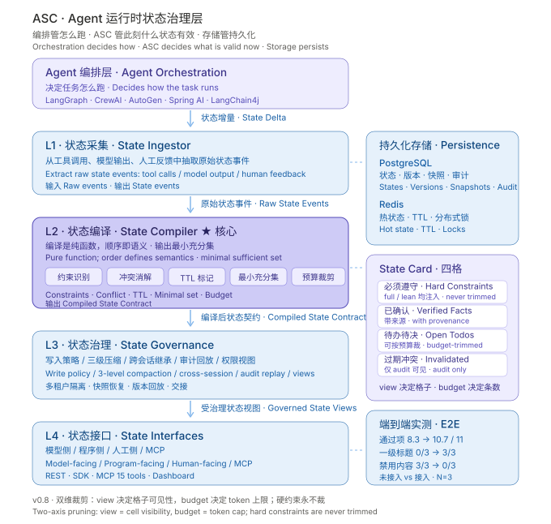

<div align="center">

# Agent StateBoard (Agent State Compiler(ASC))

**Agent 运行时状态治理层**

让 Agent 每一步都知道：什么必须遵守、什么已经确认、什么还没做、什么已经过期。

<p align="center">  
    
</p>


</div>

---

## 目录

- [为什么需要 ASC](#为什么需要-asc)
- [ASC 是什么](#asc-是什么)
- [核心概念：State Contract](#核心概念state-contract)
- [架构](#架构)
- [快速开始](#快速开始)
- [核心 API](#核心-api)
- [接入 Agent](#接入-agent)
- [评测指标](#评测指标)
- [端到端实测结果](#端到端实测结果)
- [项目状态](#项目状态)
- [Roadmap](#roadmap)
- [贡献](#贡献)
- [License](#license)

---

## 为什么需要 ASC

Agent 在长周期、多工具、多轮对话任务中，失败往往不是因为“知识不够”，而是因为**运行时状态失控**：

| 问题          | 典型表现                              |
| ----------- | --------------------------------- |
| **硬约束丢失**   | 用户一开始说“只查最近 30 天”，聊了十几轮后 Agent 忘了 |
| **事实冲突**    | 工具第一次返回销量 100，第二次返回 120，模型引用错旧值   |
| **上下文膨胀**   | 工具日志、检索片段、聊天历史全塞进去，关键信息被淹没        |
| **跨会话失忆**   | 任务暂停后恢复，上一轮确认的约束、排除的路径全部归零        |
| **交接靠聊天记录** | Agent A 交给 Agent B，只能传整段历史，又长又乱   |
| **难以审计**    | 出问题时无法回答“当时模型到底看到了什么状态”           |

现有方案的边界：

- **编排框架**（LangGraph、CrewAI、AutoGen、Spring AI、LangChain4j）负责“怎么跑”；
- **记忆 / RAG**（mem0、RAGFlow 等）负责“记住什么、知道什么”；
- **但“当前这一刻，哪些状态有效、哪些过期、哪些必须遵守、下一步该基于什么决策”** —— 这一层是空的。

ASC 就是补这一层。

---

## ASC 是什么

ASC 站在 Agent 编排层之下、存储之上，接收 Agent 执行过程中产生的原始状态流，**编译**成结构化、可审计、可回放、可继承的 **State  
Contract（状态契约）**，并治理它的全生命周期。

它做四件事：

1. **采集**：从工具返回、模型输出、人工审批中抽取状态事件；
2. **编译**：区分硬约束 / 已验证事实 / 待办 / 过期冲突，检测冲突，按 token 预算生成最小状态卡；
3. **注入**：Agent 每轮决策前，给它一张“当前有效任务状态卡”，而不是整段历史；
4. **治理**：任务快照、跨会话恢复、多 Agent 交接、版本回放与审计。

**ASC 不替代编排，不替代 RAG，不替代普通聊天记忆。** 它只回答一个问题：

> **Agent 当前这一刻，应该基于什么状态做决策？**

---

## 核心概念：State Contract

ASC 每轮交给 Agent 的不是整段历史，而是一张四格状态卡：

| 格子                         | 含义            | 示例                        |
| -------------------------- | ------------- | ------------------------- |
| **必须遵守**（Hard Constraints） | 不可覆盖的任务边界     | “只查最近 30 天”“无删除权限”        |
| **已确认事实**（Verified Facts）  | 工具或人工确认过的可信信息 | “上海上周销量 120”“city 已解析为上海” |
| **待办 / 待决**（Open Todos）    | 下一步依赖的未完成事项   | “杭州数据待查”“库存异常待确认”         |
| **过期 / 冲突**（Invalidated）   | 不应再使用的信息      | “旧销量 100 已被 120 覆盖”       |

Java 建模（示意）：

```java
public sealed interface StateItem permits Constraint, Fact, Todo, InvalidatedItem {
    String id();
    Instant createdAt();
    String source();
}

public record Constraint(String id, String text, ConstraintLevel level,
                         Instant createdAt, String source) implements StateItem {}

public record Fact(String id, String key, String value,
                   Instant createdAt, Instant expiresAt,
                   String source) implements StateItem {}

public record Todo(String id, String text, TodoStatus status,
                   Instant createdAt, String source) implements StateItem {}

public record InvalidatedItem(String id, String reason,
                              String supersededBy,
                              Instant createdAt, String source) implements StateItem {}

public record StateCard(String taskId, long version,
                        List<Constraint> hardConstraints,
                        List<Fact> verifiedFacts,
                        List<Todo> openTodos,
                        List<InvalidatedItem> invalidated,
                        int estimatedTokens) {}
```

---

## 架构

<p align="center">  
    
</p>

> 图中右侧收益卡为 v0.8 端到端实测（未接入 vs 接入 ASC，N=3），口径见[端到端实测结果](#端到端实测结果)；确定性仿真数据见[评测指标](#评测指标)。

文字版（便于终端与纯文本阅读）：

```
┌───────────────────────────────────────────────────────────────┐
│  Agent 编排层 · Agent Orchestration                       │
│  决定任务怎么跑 · LangGraph / CrewAI / AutoGen /           │
│  Spring AI / LangChain4j                                 │
└──────────────────────┬────────────────────────────────────────┘
                     │ 状态增量 · State Delta
┌──────────────────────▼────────────────────────────────────────┐
│  L1  State Ingestor（状态采集层）                          │
│  从工具调用、模型输出、人工反馈中抽取原始状态事件                │
│  Extract raw state events from tool calls / model output │
└──────────────────────┬────────────────────────────────────────┘
                     │ 原始状态事件 · Raw State Events
┌──────────────────────▼────────────────────────────────────────┐
│  L2  State Compiler（状态编译层）★ 核心                    │
│  编译是纯函数，顺序即语义 · Pure function, order = semantics │
│  约束识别 / 冲突消解 / TTL 标记 / 最小充分集 / 预算裁剪        │
│  Constraints / Conflict / TTL / Minimal set / Budget     │
└──────────────────────┬────────────────────────────────────────┘
                     │ 编译后状态契约 · Compiled State Contract
┌──────────────────────▼─────────────────────────────────────────┐
│  L3  State Governance（状态治理层）                         │
│  写入策略 / 三级压缩 / 跨会话继承 / 审计回放 / 权限视图          │
│  Write policy / compaction / cross-session / audit / views│
└──────────────────────┬─────────────────────────────────────────┘
                     │ 受治理状态视图 · Governed State Views
┌──────────────────────▼──────────────────────────────────┐
│  L4  State Interfaces（状态接口层）                  │
│  模型侧 / 程序侧 / 人工侧 / MCP                       │
│  Model-facing / Program-facing / Human-facing / MCP│
│  REST · SDK · MCP 15 tools · Dashboard             │
└─────────────────────────────────────────────────────────┘
```

存储 · Persistence：

- **PostgreSQL**：状态、版本、快照、审计 · States / Versions / Snapshots / Audit；
- **Redis**：热状态、TTL、分布式锁 · Hot state / TTL / Locks。

状态卡四格 · State Card：必须遵守 Hard Constraints（full/lean 都注入、永不裁）／已确认 Verified Facts（带来源）／待办 Open Todos（可按预算裁）／过期冲突 Invalidated（仅 audit 可见）。view 决定格子可见性，budget 决定条数上限。

---

## 快速开始

### 环境要求

按你选的启动方式准备：

| 方式          | 需要什么                                                 |
| ----------- | ---------------------------------------------------- |
| Docker 一键启动 | Docker Engine + Docker Compose（推荐，最省事）               |
| 命令行逐个启动     | JDK 21+ 与 Maven 3.9+（或 `mvnw`），外加 PostgreSQL 与 Redis |
| 无数据库本地模式    | 只要 JDK 21+ 与 Maven，适合先跑通看看                           |

### 1. 获取代码

```bash
git clone https://github.com/JackLinkai/StateBoard.git
cd StateBoard
```

### 2. 启动服务（三选一）

#### 方式 A：Docker Compose 一键启动（推荐）

一条命令把 PostgreSQL、Redis、ASC Server 全部起来：

```bash
docker compose up -d
```

三个服务通过容器名互联（应用连 `postgres:5432` 与 `redis:6379`），宿主机只暴露  
`5432` / `6379` / `8080`，**不需要写 `.env`**。等健康检查通过：

```bash
docker compose ps
curl http://localhost:8080/actuator/health     # {"status":"UP"}
```

停止用 `docker compose down`（加 `-v` 会一并删掉数据库卷）。

#### 方式 B：命令行逐个启动（自己管数据库）

适合已经装了 PostgreSQL / Redis，或想改连接参数的场景。

**第一步：先起 PostgreSQL 和 Redis。** 最省事的是让 Compose 只起这两个：

```bash
docker compose up -d postgres redis
```

或者用自己装好的服务，先在 PostgreSQL 里建库和用户：

```sql
CREATE USER asc WITH PASSWORD 'asc';
CREATE DATABASE asc OWNER asc;
```

**第二步：写本地配置。** 从示例复制一份，按你的实际连接信息改：

```bash
cp .env.example .env       # Windows 用 copy
```

```dotenv
ASC_DB_URL=jdbc:postgresql://localhost:5432/asc
ASC_DB_USERNAME=asc
ASC_DB_PASSWORD=asc
ASC_REDIS_HOST=localhost
ASC_REDIS_PORT=6379
```

`.env` 是 properties 格式，由 `application.yml` 的  
`spring.config.import: optional:file:.env[.properties]` 加载，已写入 `.gitignore`、  
不会提交到仓库。完整可选项见 [配置参考](#4-配置参考)。

**第三步：启动应用。**

```bash
./mvnw spring-boot:run      # Windows 用 mvnw.cmd spring-boot:run
curl http://localhost:8080/actuator/health
```

> 如果之前用方式 C 的 local profile 起过服务，先停掉旧进程再切，  
> 否则 health 会一直是旧配置。

#### 方式 C：无数据库的本地模式（v0.8）

没装 Docker / PostgreSQL / Redis 也能马上跑：H2 内存库 + 自动降级的热缓存。

```bash
mvn spring-boot:run -Dspring-boot.run.profiles=local
curl http://localhost:8080/actuator/health
```

H2 以 `MODE=PostgreSQL` 运行，Flyway 关闭、JPA `create-drop`，进程退出即清空；  
Redis 不可达时由 `HotStateCache` 本地兜底。适合调试、端到端脚本和 MCP 接入验证，  
**不用于持久化**；正式使用走方式 A 或 B。

### 3. 启动后怎么用

服务跑起来后有三条入口：可视化面板、REST API，以及给 AI 工具用的 MCP。

#### 3.1 打开可视化面板

**注意：方式 A（Docker）启动后看不到面板**——镜像里只有后端，没有前端页面。  
要看面板请改用方式 B 或 C，并**在本地先构建一次前端**：

```bash
# 1. 如果用方式 A 起过服务，先停掉，腾出 8080 端口
docker compose down

# 2. 构建前端（产物输出到 src/main/resources/static）
cd dashboard && npm install && npm run build && cd ..

# 3. 用方式 B 或 C 启动后端，二选一（见上一节）
./mvnw spring-boot:run                                   # 方式 B
# mvn spring-boot:run -Dspring-boot.run.profiles=local   # 方式 C：无需数据库
```

浏览器打开 `http://localhost:8080`。以后改了前端代码，重跑 `npm run build` 并重启服务即可。  
开发前端时可以用 `npm run dev`（Vite 5173，`/v1` 自动代理到 8080），改代码热更新、不用反复构建。

只用 REST API 或 MCP 的话**不需要面板**，跳过本节，用方式 A 直接启动即可。

面板里能做的事情：任务列表与创建/恢复、状态卡四格视图、待办一键完成/取消、  
快照与交接、点版本条回放。**第一次建议先在这里建一个任务、写两条约束，  
再取一次状态卡**，直观看到 ASC 到底往 Agent 上下文里注入了什么。

#### 3.2 用 REST API 走一遍最小闭环

```bash
# 建任务
curl -X POST http://localhost:8080/v1/tasks \
  -H "Content-Type: application/json" \
  -d '{"taskId":"quickstart-001","description":"快速开始示例"}'

# 写一条硬约束
curl -X POST http://localhost:8080/v1/tasks/quickstart-001/constraints \
  -H "Content-Type: application/json" \
  -d '{"text":"只回答最近 30 天的数据","level":"HARD","source":"user"}'

# 取状态卡（Agent 每轮决策前调用的就是这个）
curl "http://localhost:8080/v1/tasks/quickstart-001/state-card?budget=small&view=lean"
```

返回里的 `hardConstraints` / `verifiedFacts` / `openTodos` / `invalidated`  
就是四格状态卡。完整接口见 [核心 API](#核心-api)。

#### 3.3 接入 WorkBuddy / Cursor / Trae（MCP）

这是让 Agent **自己在每轮决策前取状态卡**的方式。ASC 的 MCP Server 把状态治理  
能力暴露成工具；它只负责状态，改文件和写代码仍由客户端自己的工具完成。

**前置条件**：ASC 服务已在 `localhost:8080` 运行，本地装好 Python 与 MCP SDK：

```bash
python -m pip install "mcp>=2"
```

**通用配置片段**（把 `<仓库绝对路径>` 换成你 clone 后的实际路径）：

```json
{
  "mcpServers": {
    "asc": {
      "command": "python",
      "args": ["<仓库绝对路径>/mcp/asc_mcp_server.py"],
      "env": {
        "ASC_BASE_URL": "http://localhost:8080",
        "ASC_TENANT": "team-a"
      }
    }
  }
}
```

各客户端把这段放在哪里、怎么启用：

| 客户端           | 配置文件                                                | 启用动作                                                      |
| ------------- | --------------------------------------------------- | --------------------------------------------------------- |
| **WorkBuddy** | `~/.workbuddy/mcp.json`                             | 合并进已有的 `mcpServers`（别覆盖其他 server），再到连接器管理页对新 server 点「信任」 |
| **Cursor**    | 项目级 `.cursor/mcp.json`，或全局 `~/.cursor/mcp.json`     | 改完 Reload Window（必要时完全重启），Agent 模式工具列表里能看到 `asc`          |
| **Trae**      | 项目级 `.trae/mcp.json`，或「设置 → MCP → 添加 → 手动添加」粘贴 JSON | 用项目级文件时，先在「设置 → MCP」打开「启用项目级 MCP」开关                       |

> Cursor 与 Trae 支持 `${workspaceFolder}` 变量，可以写成  
> `"${workspaceFolder}/mcp/asc_mcp_server.py"`，配置跟着仓库走、换机器不用改路径；  
> WorkBuddy 目前用绝对路径。`ASC_TENANT` 只是数据隔离标识，不是身份认证。


**验证接好了**：在客户端里发这一句——

```text
调用 asc 的 create_task 建任务 quickstart-mcp，再用 add_constraint 写一条 HARD 约束「只回答最近 30 天的数据」，最后用 get_state_card 取 lean 视图状态卡，把结果贴出来。
```

能看到状态卡就说明链路通了。11 个工具的完整清单，以及端到端测试扩展（15 工具版）  
见 [接入 Agent](#接入-agent)。

### 4. 配置参考

数据库 / Redis 等本地环境配置通过项目根目录的 **`.env`** 文件注入（已写入 `.gitignore`，不入库）：

```bash
cp .env.example .env    # 复制示例文件并按需修改（Windows 用 copy）
```

`.env` 按 properties 格式书写（`KEY=VALUE`），由 `application.yml` 顶部的  
`spring.config.import: optional:file:.env[.properties]` 加载；所有配置项在  
`application.yml` 中均带 `localhost` 默认值——没有 `.env` 也能以默认配置启动：

```dotenv
# .env 示例（完整项见 .env.example）
ASC_DB_URL=jdbc:postgresql://localhost:5432/asc
ASC_DB_USERNAME=asc
ASC_DB_PASSWORD=asc
ASC_REDIS_HOST=localhost
ASC_REDIS_PORT=6379

# v0.7 真实 LLM 评测（benchmarks/runner.py --agent llm）
# 服务商可插拔：切换只改 ASC_BENCH_PROVIDER，注册表见 benchmarks/providers.json
ASC_BENCH_PROVIDER=deepseek
ASC_BENCH_LLM_API_KEY=your-api-key
```

`application.yml` 中与之对应的结构（占位符 `:` 后为默认值）：

```yaml
spring:
  config:
    import: optional:file:.env[.properties]
  datasource:
    url: ${ASC_DB_URL:jdbc:postgresql://localhost:5432/asc}
    username: ${ASC_DB_USERNAME:asc}
    password: ${ASC_DB_PASSWORD:asc}
  data:
    redis:
      host: ${ASC_REDIS_HOST:localhost}
      port: ${ASC_REDIS_PORT:6379}

asc:
  compiler:
    default-budget-tokens: 1200
    fact-conflict-strategy: LATEST_WINS   # LATEST_WINS | MANUAL | REJECT
    soft-context-ttl: 30m
```

---

## 核心 API

### 1. 创建任务

```bash
curl -X POST http://localhost:8080/v1/tasks \
  -H "Content-Type: application/json" \
  -d '{"taskId": "order-check-001", "description": "检查上海最近30天销量"}'
```

### 2. 写入硬约束

```bash
curl -X POST http://localhost:8080/v1/tasks/order-check-001/constraints \
  -H "Content-Type: application/json" \
  -d '{
    "text": "只允许查询最近30天数据",
    "level": "HARD",
    "source": "user"
  }'
```

### 3. 写入工具返回事实

```bash
curl -X POST http://localhost:8080/v1/tasks/order-check-001/facts \
  -H "Content-Type: application/json" \
  -d '{
    "key": "shanghai_sales_last_7d",
    "value": "120",
    "expiresAt": "2026-10-26T00:00:00Z",
    "source": "tool:query_sales"
  }'
```

### 4. 获取状态卡（Agent 决策前调用）

```bash
curl "http://localhost:8080/v1/tasks/order-check-001/state-card?budget=small"
```

响应示例：

```json
{
  "taskId": "order-check-001",
  "version": 7,
  "hardConstraints": [
    { "id": "c1", "text": "只允许查询最近30天数据", "level": "HARD" }
  ],
  "verifiedFacts": [
    { "id": "f3", "key": "shanghai_sales_last_7d", "value": "120" }
  ],
  "openTodos": [
    { "id": "t2", "text": "杭州数据待查", "status": "OPEN" }
  ],
  "invalidated": [
    { "id": "f1", "reason": "SUPERSEDED", "supersededBy": "f3" }
  ],
  "estimatedTokens": 312
}
```

### 5. 任务快照与恢复

```bash
# 结束任务，生成快照
curl -X POST http://localhost:8080/v1/tasks/order-check-001/snapshot

# 新会话按快照恢复
curl -X POST http://localhost:8080/v1/tasks \
  -H "Content-Type: application/json" \
  -d '{"taskId": "order-check-002", "restoreFrom": "order-check-001"}'
```

### 6. 待办状态流转 / 任务列表 / 版本列表

```bash
# 待办完成（不再注入状态卡）：PATCH /v1/tasks/{id}/todos/{todoId}
curl -X PATCH http://localhost:8080/v1/tasks/order-check-001/todos/t2 \
  -H "Content-Type: application/json" \
  -d '{"status": "DONE"}'

# 任务列表（面板 / 运维）
curl http://localhost:8080/v1/tasks

# 单个任务详情
curl http://localhost:8080/v1/tasks/order-check-001

# 某任务全部已持久化的状态卡版本（回放面板 / 审计）
curl http://localhost:8080/v1/tasks/order-check-001/versions

# 关闭任务（幂等）：置 CLOSED，快照与回放保留
curl -X POST http://localhost:8080/v1/tasks/order-check-001/close
```

### 7. 版本回放

```bash
curl "http://localhost:8080/v1/tasks/order-check-001/replay?version=5"
```

---

## 接入 Agent

### Python（LangGraph / CrewAI）

安装 SDK（仅依赖 requests）：

```bash
cd sdk/python && pip install .
```

在 LLM 调用前拉取状态卡，在工具返回后写入事件：

```python
from asc import AscClient

asc = AscClient("http://localhost:8080", tenant="team-a")   # 多租户：随请求走 X-ASC-Tenant 头
asc.add_constraint("order-check-001", "只允许查询最近30天数据", level="HARD")

# 每轮决策前（view="lean" 只注入执行态三格，省 token；缺省 full）
card = asc.get_state_card("order-check-001", budget="small", view="lean")
prompt = str(card) + "\n\n用户输入：" + user_input

# 工具返回后（同 key 自动 LATEST_WINS 冲突消解）
asc.record_fact("order-check-001", "shanghai_sales", "120", source="tool:query_sales")
```

完整胶水示例：[examples/langgraph\_example.py](examples/langgraph_example.py)、[examples/crewai\_example.py](examples/crewai_example.py)。

### Java（Spring AI / LangChain4j）

Java SDK 在 `io.asc.client` 包内（服务同仓库直接可用）：

```java
AscClient asc = AscHttpClient.create("http://localhost:8080", "team-a"); // 多租户
asc.recordFact(taskId, "shanghai_sales", "120", null, "tool:query_sales");

StateCard card = asc.getStateCard("order-check-001", Budget.SMALL, CardView.LEAN);
String prompt = card.toPrompt() + "\n\n用户输入：" + userInput;
```

服务端 4xx/5xx 抛 `AscApiException`（含业务错误码，如 `TASK_NOT_FOUND`）。

### MCP

任意支持 MCP 的客户端（Trae / Claude Desktop / 自研）按需拉取状态：

```json
{
  "mcpServers": {
    "asc": {
      "command": "python",
      "args": ["mcp/asc_mcp_server.py"],
      "env": { "ASC_BASE_URL": "http://localhost:8080", "ASC_TENANT": "team-a" }
    }
  }
}
```

依赖：`pip install "mcp>=2"`。`asc_mcp_server.py` 提供 11 个工具：create_task / add_constraint / record_fact / record_todo / update_todo / close_task / get_state_card / snapshot / restore_task / replay / handoff。

### MCP 端到端测试扩展（v0.8）

额外的 [asc\_e2e\_server.py](mcp/asc_e2e_server.py) 在原版 11 个工具上加了 4 个，共 15 个：

| 工具                                     | 作用                                                                  |
| -------------------------------------- | ------------------------------------------------------------------- |
| `e2e_start(run_id, mode, description)` | 建结果目录，写 `meta.json`                                                 |
| `e2e_record_step(...)`                 | 记一步决策，`violation` / `stale_ref` / `repeated` / `resume_steps` 用于算指标 |
| `e2e_snapshot(task_id, ...)`           | ASC 快照 → ContextFS 风格节点（owner / 版本 / 可见性 / Agent 绑定）                |
| `e2e_report(run_id)`                   | 生成 `summary.json` 与 `analysis.md`                                   |

这样 WorkBuddy / Trae 接上 MCP 后能跑完整闭环：**每轮先 `get_state_card` → 用自己的文件工具改文件 → `e2e_record_step` 留痕 → 结束 `e2e_snapshot` 固化快照**。ASC 负责状态治理，文件修改由客户端自己的工具完成。

配置模板见 [e2e\_file\_edit/mcp-workbuddy.example.json](e2e_file_edit/mcp-workbuddy.example.json)，接入步骤见 [e2e\_file\_edit/README.md](e2e_file_edit/README.md)。

---

## 评测指标

ASC 的目标不是“更花哨的上下文”，而是可验证的改善。评测对比两组：

- **Baseline**：原始历史 + 工具日志全量堆砌；
- **ASC**：每轮注入编译后的状态卡。

指标：

| 指标                    | 说明                     |
| --------------------- | ---------------------- |
| **关键约束违反率**           | 任务中违反硬约束的次数 / 任务数      |
| **任务完成率**             | 端到端成功完成任务的比例           |
| **输入 token 消耗**       | 每轮平均输入 token           |
| **重复工具调用次数**          | 相同工具 + 相同参数重复调用次数      |
| **恢复任务重放步数**          | 跨会话恢复后回到原进度所需步数        |
| **过期事实引用率**（v0.7）     | 引用了已被覆盖 / 失效旧值的次数      |
| **真实 Token 成本**（v0.7） | 按实际 usage 与模型单价折算的美元成本 |
| **完成率方差**（v0.7）       | 同一场景重复 N 次的均值 ± 标准差    |

> 评测数据集与脚本已随 v0.4 开源：[benchmarks/](benchmarks/)。

运行（需先启动 asc-server）：

```bash
# v0.4 确定性 MockAgent（回归 / 离线验证）
python benchmarks/runner.py --window 350 --json-out results.json

# v0.7 真实 LLM（L1）：默认 DeepSeek，也可任意 OpenAI 兼容端点
python benchmarks/runner.py --agent llm --repeats 5 \
  --trace-dir benchmarks/results \
  --json-out benchmarks/results/v07-l1.json

# 查看已注册的服务商与默认模型
python benchmarks/runner.py --list-providers
```

服务商可插拔：注册表在 [benchmarks/providers.json](benchmarks/providers.json)，  
内置 `deepseek` / `ollama` / `openai` / `qwen` / `custom`。切换只改配置或命令行，不改代码：

```bash
# 本地 Ollama（无需密钥；先 ollama pull qwen2.5:7b 并确认服务已启动）
python benchmarks/runner.py --agent llm --provider ollama --model qwen2.5:7b

# 任意自建 / 第三方 OpenAI 兼容端点
python benchmarks/runner.py --agent llm --provider custom \
  --llm-base-url http://localhost:8000/v1 --model my-model
```

新增服务商只需在 `providers.json` 加一项（`api_style` / `base_url` /  
`api_key_envs` / `requires_api_key` / `default_model`）。当前只实现了  
`api_style=openai_chat`；接入非 OpenAI 协议（如 Anthropic Messages）需在  
[benchmarks/bench\_llm.py](benchmarks/bench_llm.py) 的 `create_chat_client` 中  
增加对应客户端——这是唯一扩展点。

真实 LLM 需要在 `.env` 中配置（密钥不入库）：

```dotenv
ASC_BENCH_PROVIDER=deepseek
ASC_BENCH_LLM_API_KEY=your-api-key
# 也支持按服务商覆盖：ASC_BENCH_DEEPSEEK_MODEL / ASC_BENCH_OLLAMA_BASE_URL 等
```

`--agent llm` 的决策协议是固定 JSON（`EXECUTE` / `REJECT` / `SKIP` + `query` +  
`citation` + `reason`），两组共用同一系统提示与输出格式，唯一差异是上下文：  
Baseline 注入原始历史，ASC 注入编译后的状态卡。判分优先规则化，逐轮 trace  
写入 `--trace-dir/<run_id>/raw.jsonl`，便于复核模型当时看到的内容。

数据集在 [benchmarks/datasets/](benchmarks/datasets/)（JSONL，每行一个场景），当前包含三类场景：

| 场景                   | 考察点                         |
| -------------------- | --------------------------- |
| `constraint_erosion` | 开场约束被多轮干扰稀释后，Agent 是否还守得住边界 |
| `fact_conflict`      | 数仓修正后，Agent 是否引用唯一有效值而不是旧值  |
| `resume_progress`    | 跨会话恢复后，回原进度要几步、重复查询有多少      |

MockAgent 是确定性规则解析器（无 LLM），两组行为差异完全由"注入内容的质量"驱动。一次 v0.4 实测（窗口 350 字符，3 场景）：

| 指标           | Baseline | ASC    |
| ------------ | -------- | ------ |
| 约束违反率/场景     | 0.33     | **0**  |
| 重复工具调用总数     | 3        | **0**  |
| 平均每轮输入 token | 161      | **47** |
| 恢复重放步数总数     | 2        | **1**  |

v0.7 的真实 LLM 数据不混入上表：`--agent llm` 会单独产出 JSON 结果与逐轮 trace，  
模型、温度、重复次数与上下文窗口都记录在结果文件里，便于复现与对比。

### 确定性仿真：真实文件修改任务（v0.8）

目录：[e2e\_file\_edit/](e2e_file_edit/) · 结果：[results/e2e-20261121-1120/](e2e_file_edit/results/e2e-20261121-1120/) · 手册：[README.md](e2e_file_edit/README.md)

这组是**确定性仿真**：决策器是规则脚本而不是大模型，用来隔离「注入内容质量」这一变量；但文件修改是真实磁盘 I/O。两组从同一模板复制 `config.json`。Baseline 拿整段历史原文（含已作废的 region、已过期的 target、软约束 retries）；ASC 组建任务、写 3 条 HARD + 1 条 SOFT、写冲突事实与过期事实、写待办，每步取状态卡。ASC 组再做 snapshot → restore 跨会话恢复。

| 指标           | Baseline |             ASC |
| ------------ | -------: | --------------: |
| 注入 token（估算） |      315 | **153（−51.4%）** |
| 硬约束违反        |        2 |           **0** |
| 过期/被覆盖事实引用   |        2 |           **0** |
| 重复编辑         |        1 |           **0** |
| 恢复重放步数       |        3 |           **1** |
| 最终文件正确       |        否 |           **是** |

最终文件：`baseline` 写成 `{"timeout":45,"region":"beijing","retries":5}`（错），`asc` 写成 `{"timeout":50,"region":"shanghai","retries":2}`（对）。决策器确定性、文件 I/O 真实，所以它证明的是注入层收益，不是模型行为；真实会话的对照见[端到端实测结果](#端到端实测结果)。

---

## 端到端实测结果

v0.8 的端到端实测指**真实 WorkBuddy 会话**：不接 ASC 与接 ASC 的三组独立会话，每组重复 3 次。任务描述、素材与输出要求完全相同，唯一差异是注入的上下文。原始数据、trace 与分析都已入库，可复现。

### 内容生成（真实 WorkBuddy 会话，N=3）

目录：[e2e\_article/](e2e_article/) · 结果：[results/e2e-article-20261121-1200/](e2e_article/results/e2e-article-20261121-1200/) · 手册：[README.md](e2e_article/README.md)

**测试内容**：同一个公众号推文写作任务，开三组独立 WorkBuddy 会话，每组重复 3 次。任务描述、素材路径、输出要求完全相同，唯一差异是注入的上下文：

- **A 未接入**：只有任务书和 5 个素材路径；
- **B 接入 ASC**：任务书 + `lean` 状态卡（362 token，8 条硬约束、13 条带来源事实、7 条待办；过期事实被治理层移出）；
- **C 等量无治理**：与 B 等量事实（约 10.0k vs 9.7k 字符），但硬约束降为软约束、过期旧值当有效事实并列注入（消融对照）。


环境：PostgreSQL + Redis，地址与凭据由项目根目录 `.env` 注入（不入库），配置方法见 [配置参考](#4-配置参考)。

| 指标              |       A 未接入 |       B 接入 ASC |     C 等量无治理 |
| --------------- | ----------: | -------------: | ----------: |
| 通过项 / 11        |   8.3 ± 0.5 | **10.7 ± 0.5** |   9.3 ± 0.5 |
| 四主题一级标题数        |   0.0 ± 0.0 |  **4.0 ± 0.0** |   0.0 ± 0.0 |
| 禁用内容类别数         |   1.7 ± 0.5 |  **0.0 ± 0.0** |   0.3 ± 0.5 |
| 字数达标（2500–3500） |         1/3 |        **3/3** |         2/3 |
| 反引号术语数          | 86.3 ± 11.1 | 86.7 ± **3.4** | 60.0 ± 10.7 |

素材里真实存在旧值（过时的材料版本、旧的工具数量口径、含编程语言名的旧账号名），A 组 3 次有 3 次命中，B 组 0 次。**B vs C 信息量相等、关掉治理就回退**，说明收益来自治理而非信息量。选用稿：B-r3，成品见 [articles/B-r3.md](e2e_article/results/e2e-article-20261121-1200/articles/B-r3.md)（标题即成品文件名）。

### 口径与边界（引用数据时应保留）

1. 本节是独立 WorkBuddy 会话，无法固定 temperature，三次产物不同属正常方差；N=3 只作方向性判断。
2. token 均为估算（CJK 1 字符≈1 token，其余 4 字符≈1 token），只用于相对比较，不作绝对成本承诺。
3. 只测注入层的收益，不证明端到端模型能力提升；机器判分不覆盖可读性、吸引力等主观质量。
4. 实测保留原始 trace、状态卡与最终产物，见结果目录的 `analysis.md` / `summary.md`。
5. 文件修改那组是确定性仿真、决策器为规则脚本，已移入[评测指标](#评测指标)，两者口径不同、不可混报。

---

## 项目状态

**Early Development（早期开发）**。当前重点是验证核心概念：

- [x] 概念设计与架构定义
- [x] State Contract 四类状态建模
- [x] Spring Boot 服务骨架 + REST API
- [x] 状态编译核心（约束识别 / 冲突消解 / TTL / 预算裁剪）
- [x] PostgreSQL + Redis 持久化
- [x] 任务快照 / 恢复 / 回放
- [x] 多 Agent 状态交接
- [x] LangGraph / CrewAI HTTP 适配示例（[examples/](examples/)）
- [x] Spring AI / LangChain4j 适配示例（Java SDK `io.asc.client`）
- [x] MCP Server（[mcp/asc\_mcp\_server.py](mcp/asc_mcp_server.py)）
- [x] 可视化调试面板（[dashboard/](dashboard/)，构建后随服务访问 `http://localhost:8080`）
- [x] 评测数据集与脚本（[benchmarks/](benchmarks/)）
- [x] 真实 LLM 评测管线（L1：结构化决策 / 规则判分 / 成本统计 / 逐轮 trace）
- [x] 冲突消解策略插件化（LATEST_WINS / MANUAL / REJECT）
- [x] 多租户隔离（`X-ASC-Tenant` 请求头）与状态卡权限视图（full / lean / audit）
- [x] 本地 H2 模式（`application-local.yml`，无 Docker 启动）
- [x] MCP Server 端到端扩展（15 工具，含留痕 / 快照 / 报告）
- [x] ASC 快照 → ContextFS 风格节点桥接（owner / 版本 / 可见性 / Agent 绑定）
- [x] 端到端实测（真实 WorkBuddy 会话 N=3）+ 确定性仿真（文件修改，隔离注入质量）

> 勾选状态请以实际仓库进度为准。详细设计见 [docs/architecture.md](docs/architecture.md)

---

## Roadmap

### v0.1 — 核心服务（MVP）✅

- REST API：任务、约束、事件、状态卡
- 最简编译器：硬约束保留、事实覆盖、待办过滤、预算截断
- PostgreSQL 持久化 + 版本号
- Docker Compose 一键启动

### v0.2 — 治理能力 ✅

- 任务快照与跨会话恢复
- 多 Agent 状态交接
- 版本回放与审计 API
- Redis 热状态与 TTL

### v0.3 — 生态接入 ✅

- LangGraph / CrewAI 示例与 Python SDK（[sdk/python](sdk/python/)）
- Spring AI / LangChain4j Starter（Java SDK `io.asc.client`）
- MCP Server（[mcp/asc\_mcp\_server.py](mcp/asc_mcp_server.py)）

### v0.4 — 可观测与评测 ✅

- React 可视化面板（任务列表 / 状态卡四格视图 / 版本回放 / 待办流转 / 交接）
- 评测数据集与脚本（[benchmarks/](benchmarks/)，Baseline vs ASC 五指标对比）
- 任务列表 / 待办状态流转 / 版本列表 API（`GET /v1/tasks`、`PATCH /v1/tasks/{id}/todos/{id}`、`GET /v1/tasks/{id}/versions`）
- Dockerfile + Docker Compose 一键启动 asc-server

### v0.5 — 编译策略演进 ✅

- **冲突消解策略插件化**：配置 `asc.compiler.fact-conflict-strategy` 一键切换——
  - `LATEST_WINS`（默认）：同 key 最新事实进卡，旧值转 SUPERSEDED，可看到完整演变链；
  - `MANUAL`：冲突不自动裁决，该 key 全部候选转 CONFLICT 等人工确认，宁可缺不可错；
  - `REJECT`：写入时就拒绝同 key 异值（409 `CONFLICT_DETECTED`），编译侧兜底拦截；
  - 扩展：实现 [FactConflictResolver](src/main/java/io/asc/core/conflict/FactConflictResolver.java) SPI + `@Component` 即注册新策略，编译器零改动。

### v0.6 — 多租户与权限视图 ✅

- **多租户隔离**：任务归属租户（Flyway V4 迁移），请求头 `X-ASC-Tenant` 声明身份，  
  缺省 `default`（存量调用方零改动）。跨租户读写一律 404（与任务不存在同响应，防探测）；  
  恢复的新任务继承源任务租户；REST / SDK / MCP / 面板全链路支持。
- **状态卡权限视图**：`GET state-card?view=`——
  - `full`（默认）：四格全量；
  - `lean`：只留必须遵守 / 已确认事实 / 待办，给 token 敏感的执行型 Agent；
  - `audit`：只留过期/冲突 / 软约束，给审计回看。  
    view 决定格子可见性（权限维度），budget 决定 token 上限（容量维度）：  
    先 view 裁格、再 budget 裁条，不可见的格子不占预算。

### v0.7 — 真实 LLM 端到端评测（L1 已实现，L2/L3 规划中）

当前评测（v0.4）的决策器是**确定性 MockAgent**（规则解析，无 LLM）：它隔离了模型变量，  
证明了注入层本身的收益（token -70.8%、约束违反 33.3%→0%），但测不了模型的随机行为。  
v0.7 把决策器换成真实 LLM，在端到端链路上验证并量化同样的结论。

**L1 已实现**：

- `benchmarks/runner.py --agent llm`：任意 OpenAI Chat Completions 兼容端点，  
  服务商可插拔（[providers.json](benchmarks/providers.json)：DeepSeek / Ollama /  
  OpenAI / Qwen / custom），固定 JSON 决策协议（`EXECUTE` / `REJECT` / `SKIP` +  
  `query` + `citation` + `reason`）；
- 规则判分：约束越界、**过期事实引用**、参数漂移、误拒绝、重复调用、恢复重放步数；
- 真实 `usage` 计费（`benchmarks/models.json` 维护上下文窗口与单价）与完成率均值 ± 方差；
- 逐轮 trace（prompt 上下文 / 决策 / usage）写入 `--trace-dir/<run_id>/raw.jsonl`；
- `--view full|lean|audit` 可直接做权限视图对照实验；
- 回归保障：`--agent mock` 与 v0.4 结果逐项一致；[离线单测](benchmarks/tests/test_bench.py)  
  覆盖 JSON 解析、过期引用判分、成本计算与 JSON mode 回退。

真实模型运行需在 `.env` 配置密钥（不入库）；L1 的原始数据与报告在配置密钥后由  
`--json-out` / `--trace-dir` 产出。

- **实验设计**：对照组不变（Baseline 全量历史 vs ASC 状态卡注入），同一模型、温度 0、  
  结构化决策输出（EXECUTE / REJECT / SKIP + 引用的事实值）；判分优先规则化  
  （查询参数是否越界、引用值是否等于工具真值），模糊情形才引入 LLM-as-judge（与被测模型不同源）；
- **指标扩展**（在现有五指标之上）：
  - 真实约束违反率：模型实际发起越界查询的比例；
  - **过期事实引用率**：引用已被 SUPERSEDED / EXPIRED 值的次数（LLM 特有失效模式）；
  - 真实计费成本：prompt + completion 按模型定价折算；
  - 完成率以均值 ± 方差报告（每场景 N≥5 次重复）；
- **模型矩阵**：闭源旗舰（GPT-4o / Claude 级）+ 国产（DeepSeek / Qwen 级）+ 7B-14B 小模型，  
  覆盖 8k / 128k / 1M 上下文档位——重点回答"**上下文越长，ASC 的收益还剩多少**"  
  （对照无截断实验的 -68.0%，验证长上下文模型下成本节省是否依然成立）；
- **待验证假设**：
  1. 失效格标注（EXPIRED / SUPERSEDED）能否显著降低模型对旧值的引用；
  2. `lean` 视图裁掉软约束与失效格后，完成率损失是否可接受（view 裁格的收益/风险量化）；
  3. 干扰文本密度与轮次增加时，状态卡相对全量历史的优势是扩大还是收敛；
- **阶段**：
  - L1（MVP，已实现）：1 个模型 × 3 场景 × 5 次重复，跑通结构化输出解析 / 自动判分 / 成本统计管线；
  - L2：模型矩阵 × 场景扩充（干扰密度梯度、30+ 轮长任务）；
  - L3：真实多工具任务（非玩具场景），评测结果页开放可复现脚本与原始数据；
- **交付物**：`benchmarks/runner.py --agent llm` 扩展（已完成）、评测报告与原始数据入库（待真实密钥运行）、技术文章一篇。

### v0.8 — 真实工作负载端到端验证 ✅

把 ASC 从「玩具场景 + 确定性决策器」推进到真实工作负载：MCP 直连 WorkBuddy / Trae、真实会话内容生成；确定性仿真保留在评测章节，用于隔离注入层变量。

- **本地 H2 模式**：`application-local.yml` + H2 依赖，无 Docker / PostgreSQL / Redis 也能启动（`mvn spring-boot:run -Dspring-boot.run.profiles=local`）；Redis 不可达时 `HotStateCache` 自动降级，health indicator 关闭。
- **MCP 扩展到 15 工具**：新增 `e2e_start` / `e2e_record_step` / `e2e_snapshot` / `e2e_report`（[mcp/asc\_e2e\_server.py](mcp/asc_e2e_server.py)），支持「取状态卡 → 改文件 → 留痕 → 快照」完整闭环。
- **ContextFS 桥接**：ASC 快照落成 `ctxfs://task/{id}/snapshots/v{n}` 风格节点，带 owner / version / visibility / agent_binding；配置 `CONTEXTFS_BASE_URL` 后同步写真实 ContextFS。
- **端到端实测 · 内容生成**：真实 WorkBuddy 会话三组对照 N=3，通过项 8.3 / 10.7 / 9.3，四主题一级标题 0/3 对 3/3 对 0/3，禁用内容命中 3/3 对 0/3（[结果](e2e_article/results/e2e-article-20261121-1200/)）。
- **确定性仿真 · 文件修改**：规则决策器隔离注入质量，token −51.4%、硬约束违反 2→0、最终文件由错改对，见[评测指标](#评测指标)（[结果](e2e_file_edit/results/e2e-20261121-1120/)）。

### 长期

- 状态压缩的三级折叠（会话 → 任务 → 经验）
- 跨任务经验复用
- 租户级正式鉴权（当前以 `X-ASC-Tenant` 头做数据隔离，非身份认证）

---

## 贡献

欢迎 Issue、Discussion 和 PR。请先阅读 [CONTRIBUTING.md](CONTRIBUTING.md)。

适合切入的方向：

- 状态编译策略（冲突消解、压缩、预算裁剪）
- Agent 框架适配器
- 评测数据集设计
- 文档与示例

如果这个方向对你有用，欢迎 Star 支持。

---

## License

[Apache-2.0](LICENSE)

---

<div align="center">

**Every step, a valid state.**  
每一步，都有有效状态。

</div>

---

---

## ❤️ 支持本项目

ASC 是一个由社区驱动的开源项目。如果它对你的工作有帮助，欢迎支持我们的持续开发与维护。

<p align="center">  
    
    
</p>
